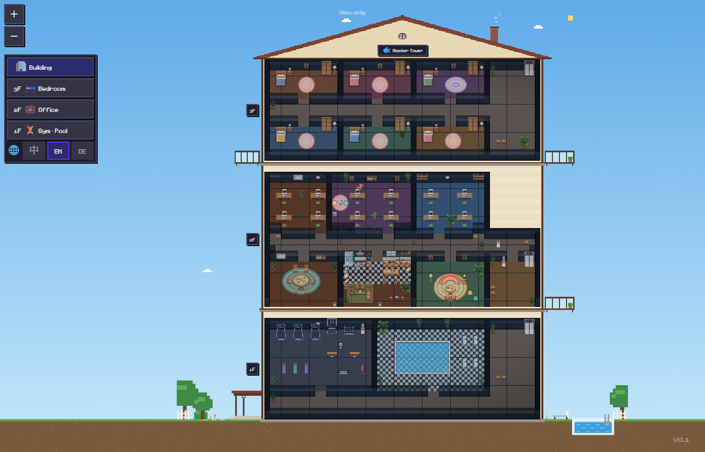
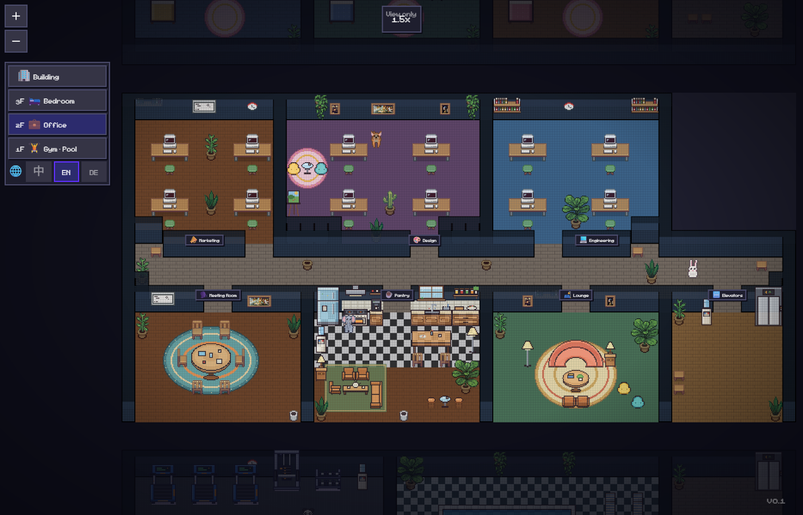
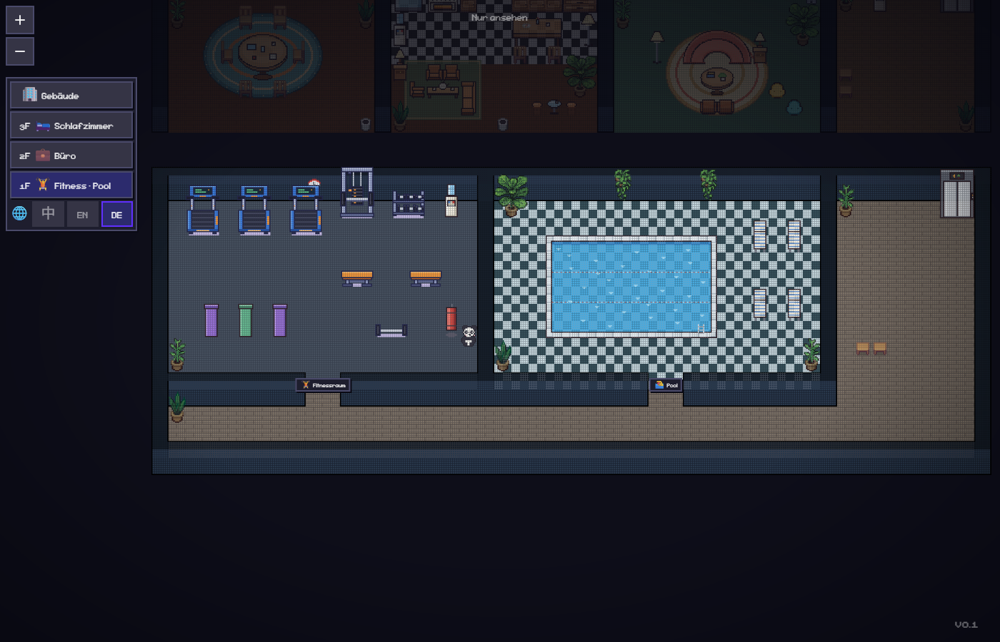

# 🐟 Slacker Tower · 摸鱼大厦

**中文** · [English](#english) · [Deutsch](#deutsch)


一栋三层的像素小楼，你的 Claude Code 助手就住在里面：干活的时候坐在工位上敲键盘，空下来就去喝水、吃饭、跑步、游泳，困了回自己的卧室睡觉。楼里还住着七只小动物：小兔子、大象、熊猫、小狗，还有三只猫（其中一只黑色缅因、一只狸花猫）。

它有两个用处：一眼看清每个助手在干嘛、谁在等你回复；另外，你发呆摸鱼的时候，也可以看看这些小人和小动物在忙什么。

> 本项目基于 [Pixel Agents](https://github.com/pixel-agents-hq/pixel-agents)（作者 Pablo De Lucca，MIT 许可证）修改而来。感谢原作者！

## 有什么

- **三层楼**：3F 卧室（六间）和猫舍、2F 办公室（市场部、设计部、技术部、会议室、茶水间、休息区）、1F 健身房和泳池。小人坐电梯上下楼。
- **全楼剖面图**：打开就是整栋别墅的正面剖面，有斜屋顶、阁楼、冒烟的烟囱、阳台、院子和泳池，天空跟着你电脑的时间变化。左边点哪层就进哪层。
- **有生活的小人**：干活时回工位；空闲时去喝水、喝咖啡、吃饭、发呆、跑步、举铁、游泳，或者回卧室睡觉。
- **提醒你照顾自己**：9:00–22:00 每个整点提醒喝水，8:00、12:00、18:00 提醒吃饭，提醒时整栋楼的小人会一起去休息。
- **团队面板**：右上角列出每个助手的任务、正在做什么，哪个在等你授权或回复。
- **角色**：每个"文件夹"（Directory）就是一个角色，有固定的样子、名牌和自己的工位，可以绑定到部门。
- **不会穿模**：人和动物会互相让路，不会从对方身上穿过去。
- **每只动物都有性格**：狗最爱跟人，兔子一蹦一跳，大象慢吞吞地去泳池边，熊猫一发呆就是半分钟；猫会爬上猫爬架、钻进猫窝或跳到床上睡觉 💤。
- **动物打闹**：冤家（狗和猫、大象和熊猫）碰上了会瞪眼 💢、滚成一团灰尘云，然后一只晕乎乎地跑掉 💫；好朋友见面会贴贴 💕。
- **三种语言**：中文、English、Deutsch，第一次打开时按浏览器语言自动选择，左边楼层面板里可以随时切换。

## 安装

需要：[Node.js 22](https://nodejs.org/) 和 [Claude Code](https://claude.com/claude-code)。

**浏览器版（推荐）**

```bash
git clone https://github.com/404tsc/slacker-tower.git
cd slacker-tower
npm install
npm run package
node dist/cli.js
```

然后在浏览器里打开终端里显示的地址。

**VS Code 插件**：在 [Releases](https://github.com/404tsc/slacker-tower/releases) 下载 `.vsix` 文件，在 VS Code 里选择"从 VSIX 安装"。

> ⚠️ 摸鱼大厦和原版 Pixel Agents 共用设置文件夹 `~/.pixel-agents`，请不要同时运行两者。

## 自己改素材

家具和宠物都是用代码画的：`scripts/slacker/draw-furniture.cjs`、`scripts/slacker/draw-pets.cjs`。改完运行它们，再 `npm run package` 即可。默认的三层楼布局在 `webview-ui/public/assets/default-layout-2.json`，也可以在应用里点"布局"直接编辑。

---

<a id="english"></a>

# 🐟 Slacker Tower — English



A three-storey pixel-art tower where your Claude Code agents live. They type at their desks while they work, and when they're free they grab water, eat, run on the treadmill, swim, or nap in their own bedroom. Seven pets live there too: a bunny, an elephant, a panda, a dog and three cats (including a black Maine Coon and a Dragon Li).

It's useful (see at a glance what every agent is doing and who is waiting for you) and it's fun to watch while you zone out.

> Based on [Pixel Agents](https://github.com/pixel-agents-hq/pixel-agents) by Pablo De Lucca (MIT). Thank you!

**Features:** 3 floors (bedrooms & a cattery · office · gym & pool) linked by elevators · a cut-away villa overview with a sky that follows your clock · agents take breaks (drink, coffee, eat, chill, work out, swim, sleep) · water reminders every hour 9–22 and meal reminders at 8/12/18 · a team panel with every agent's task and status · roles with fixed looks, name tags and own desks · people and pets give way instead of walking through each other · every pet has a personality (the dog follows people, the bunny hops, the panda is lazy, cats nap on cat trees and beds) · rivals have cartoon scuffles in a dust cloud, friends cuddle · Chinese, English and German UI (follows your browser).

**Install:** needs Node.js 22 and Claude Code. `git clone https://github.com/404tsc/slacker-tower.git && cd slacker-tower && npm install && npm run package && node dist/cli.js`, then open the printed URL. A VS Code `.vsix` is on the Releases page. Slacker Tower shares the `~/.pixel-agents` settings folder with the original Pixel Agents, so don't run both at once.



---

<a id="deutsch"></a>

# 🐟 Faulenzer-Turm — Deutsch



Ein dreistöckiges Pixel-Art-Haus, in dem deine Claude-Code-Agenten wohnen: Bei der Arbeit sitzen sie am Schreibtisch, in Pausen trinken sie Wasser, essen, laufen auf dem Laufband, schwimmen oder schlafen in ihrem eigenen Zimmer. Dazu sieben Haustiere: Hase, Elefant, Panda, Hund und drei Katzen (darunter eine schwarze Maine Coon und eine Dragon Li) – jedes mit eigenem Charakter. Rivalen raufen sich in einer Staubwolke, Freunde kuscheln. Praktisch, um zu sehen, was jeder Agent gerade macht – und schön zum Zuschauen, wenn man mal abschalten will.

> Basiert auf [Pixel Agents](https://github.com/pixel-agents-hq/pixel-agents) von Pablo De Lucca (MIT).

**Installation:** Node.js 22 und Claude Code werden benötigt. `git clone https://github.com/404tsc/slacker-tower.git && cd slacker-tower && npm install && npm run package && node dist/cli.js`, dann die angezeigte Adresse im Browser öffnen. Die Oberfläche gibt es auf Deutsch, Englisch und Chinesisch.

## License

MIT — see [LICENSE](LICENSE). Original work © Pablo De Lucca (Pixel Agents).
